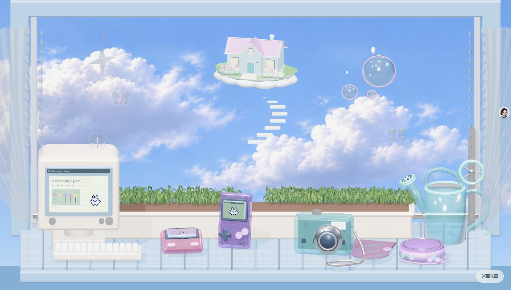
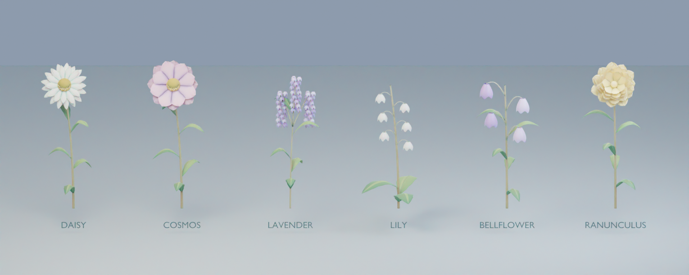

# Little Garden · 云上的一扇窗

An interactive windowsill garden built in Blender and Three.js. Choose a flower, drag the watering can, and grow twelve blooms to reveal a house in the clouds.

## Experience

1. Curtains open onto an initially unplanted windowsill with layered groundcover.
2. Click the handheld console to choose from six flowers: daisy, cosmos, lavender, lily of the valley, bellflower and ranunculus.
3. Click exposed soil to plant; drag the watering can over a flower and hold until watering completes. Release to return the can.
4. Flowers grow and remain visible. Twelve fully grown, watered flowers unlock the cloud cottage and piano finale.
5. The computer opens garden records and settings; the camera saves a picture. Reward preview does not unlock completion.

Clouds drift, bubbles rise, butterflies flutter, stars turn, vegetation sways, and pixel pets animate on the screens. Day/night lighting and synthesized ambient audio support the scene. Sound may need a click to start under browser autoplay rules.

## Run

Node.js 18 or newer; no package installation or API keys required.

```sh
npm start
```

Open http://127.0.0.1:4173. Use an HTTP server, not a double-clicked HTML file. Progress is stored in this browser and origin; localhost and 127.0.0.1 have separate saves.

```sh
npm test
npm run build
```

The static website is emitted to `_site/`. Deploy that folder. The included GitHub Actions workflow tests, builds and deploys it to GitHub Pages when Pages uses GitHub Actions as its source. Blender archives and documentation are excluded from the deployed site.

## Files

| Location | Purpose |
| --- | --- |
| `app.js` | Scene loading, planting, pointer watering and persistence |
| `plant-growth.js` | Deterministic growth sampling and stable final scale |
| `garden-life.js`, `garden-effects.js` | Lighting, ambient animation, audio and curtains |
| `garden-reward.js`, `garden-cottage.js` | Twelve-flower completion gate and real-time cottage reveal |
| `cloud-mist.js` | Soft procedural cloud transition planes |
| `assets/` | Five Blender GLB exports, image textures and piano audio |
| `source/` | Compressed editable Blender studies and scene files |
| `docs/images/` | Web captures and Blender modelling studies |
| `legacy/procedural-v1/` | Preserved earlier procedural prototype |

The GLBs are bundled locally. Initial loading still depends on connection speed and GPU performance; Blender rendering and browser rendering are visually different. Gzip companions support the local server; standard GLBs remain for static hosts.

## Portfolio

[Web experience in Figma](https://www.figma.com/design/cjCqxD4qbJ1GFQF68zbF2G/?node-id=553-1531) · [Blender modelling page](https://www.figma.com/design/cjCqxD4qbJ1GFQF68zbF2G/?node-id=598-2238)





## Credits and limits

Creative direction and iterative feedback by the project owner; substantial AI-assisted modelling, textures, animation, development and documentation with OpenAI Codex. See [PROCESS.md](PROCESS.md) for the contribution and validation record, and [THIRD_PARTY_NOTICES.md](THIRD_PARTY_NOTICES.md) for dependencies.

This is a portfolio prototype. Full manual completion, physical mobile devices, keyboard-only planting and comprehensive accessibility/cross-browser testing remain outstanding. Saves are local, with no account or cloud sync. Original project files have no additional open-source licence assigned.
